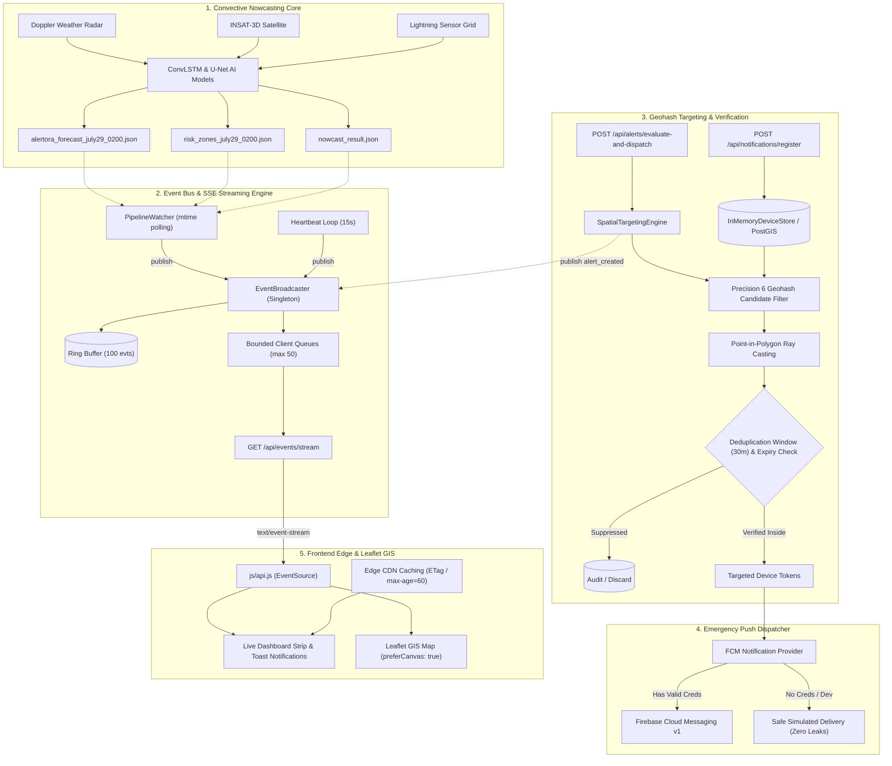

# ALERTORA AI — Real-Time Alert Delivery & Geospatial Targeting Architecture
**Smart India Hackathon (SIH26084)** — High-Performance Convective Severe-Weather Nowcasting Platform

---

## 1. Executive Summary
The **Alertora Real-Time Architecture** upgrades the convective nowcasting platform from static periodic batch updates to a production-grade, event-driven streaming and spatial delivery engine. 

Designed specifically for severe weather hazards (thunderstorms, cloudbursts, severe lightning, hail) across the IMDAA domain (lat 25.08°–27.00°N, lon 82.08°–84.00°E), Alertora bridges high-resolution ConvLSTM / U-Net machine learning forecasts directly to ground-level early warning mechanisms in sub-second latencies.

```
+---------------------------------------------------------------------------------------------------+
|                                  ALERTORA ARCHITECTURE OVERVIEW                                   |
|                                                                                                   |
|  [ML Pipeline Outputs] ----> [Pipeline Watcher] ----> [Real-Time Event Bus] ----> [SSE Stream]    |
|  - July 29 Forecast           (mtime detection)        - Ring Buffer (100)        - Disconnect GC |
|  - Risk Zones (17x17)                                  - Bounded Queues (50)      - Reconnect     |
|  - Storm Trajectories                                                                             |
|                                                                                                   |
|  [Emergency Trigger]  ----> [Spatial Targeting]  ----> [FCM Push / Cell Bcast]   [Web / Mobile]   |
|  - District / Horizon        - Precision 6 Geohash     - Safe Dry-Run Fallback    - Canvas Leaflet|
|  - Risk Polygons             - Point-in-Polygon Ray    - Zero Credential Leaks    - Live SSE Badge|
|                              - 30-Min Dedup Window     - Bounded Backoff Retries                  |
+---------------------------------------------------------------------------------------------------+
```

---

## 2. End-to-End System Architecture



---

## 3. Server-Sent Events (SSE) Streaming Pipeline

### 3.1 Endpoint & Event Stream Specification
- **Endpoint:** `GET /api/events/stream`
- **Protocol:** HTTP/1.1 or HTTP/2 `text/event-stream`
- **Headers:**
  ```http
  Content-Type: text/event-stream
  Cache-Control: no-cache, no-transform
  Connection: keep-alive
  X-Accel-Buffering: no
  Access-Control-Allow-Origin: *
  ```

### 3.2 Standard Event Types
| Event Type | Source | Frequency | Payload Description |
| :--- | :--- | :--- | :--- |
| `forecast_updated` | PipelineWatcher | On file update | Updated IMDAA 17x17 grid points, lead horizons (+1h to +6h) |
| `risk_zones_updated` | PipelineWatcher | On file update | High-risk bounding boxes, thresholded cells count |
| `storm_trajectory_updated` | PipelineWatcher | On file update | Convective storm centroid tracking vectors and forecast positions |
| `alert_created` | Alert Dispatcher | Event-driven | Real-time emergency warning, targeted district, ETA, required action |
| `system_status_updated` | FastAPI Engine | State change | Sensor health, AI confidence score, active model versions |
| `heartbeat` | Broadcaster | Every 15 seconds | Server timestamp keep-alive, active connected client count |

### 3.3 Reliability & Resilience Controls
1. **Bounded Queues:** Each connected SSE client is allocated an `asyncio.Queue(maxsize=50)`. Slow clients dropping below consumption thresholds drop the oldest queued event rather than causing server memory leakage.
2. **Ring Buffer & Reconnection (`Last-Event-ID`):** A circular ring buffer of the last 100 events (`deque(maxlen=100)`) enables clients reconnecting after network drops to replay missed events by providing the standard `Last-Event-ID` HTTP header.
3. **Heartbeat Keep-Alive:** Every 15 seconds, a heartbeat event is broadcast. In idle periods, a `: keep-alive ping\n\n` comment frame is flushed to prevent proxy/NAT timeout disconnects.
4. **Client Garbage Collection:** When `request.is_disconnected()` is detected, client queues are detached and cleaned from memory.

---

## 4. Geohash Spatial Emergency Targeting Engine

### 4.1 Precision 6 Geohashing
Alertora employs pure-Python Base-32 Geohashing:
- **Precision 6 Cell Size:** Approximately **1.2 km × 0.6 km** ($0.0055^\circ \text{lat} \times 0.011^\circ \text{lon}$).
- **Rationale:** Aligns with standard Indian cellular telecom tower coverage radii and municipal emergency response sectors.
- **Inverted Spatial Index:** Devices are bucketed by their 6-character geohash prefix. Spatial queries execute in **$O(1)$** candidate retrieval time.

### 4.2 Multi-Stage Spatial Verification Pipeline
```
[Hazard Bounding Box / Polygon]
          |
          v
[1. Candidate Geohashes Discovery]  ---> Identifies all Precision-6 cells covering the hazard
          |
          v
[2. Inverted Index Lookup]          ---> Pulls device records matching candidate cells
          |
          v
[3. Exact Point-in-Polygon Check]   ---> Ray-Casting algorithm confirms exact coordinate inclusion
          |
          v
[4. Deduplication & Expiry Filter]  ---> Suppresses repeated hazard alerts within 30-min window
          |
          v
[Targeted Device Tokens]
```

### 4.3 Ray-Casting Point-in-Polygon
Alertora executes the ray-casting algorithm to test whether device coordinate $(y_{\text{lat}}, x_{\text{lon}})$ is inside arbitrary polygon vertices:
$$\text{intersect} \iff (y_1 > y \ne y_2 > y) \land \left(x < \frac{(y - y_1)(x_2 - x_1)}{y_2 - y_1} + x_1\right)$$

### 4.4 Deduplication & Expiry Enforcement
- **Deduplication Window:** Configured to **30 minutes** (`ALERT_DEDUPLICATION_WINDOW_MINUTES`). Devices within an active risk cell will not receive duplicate push notifications for the same hazard type, preventing user alert fatigue.
- **Alert Expiration:** Alerts exceeding their `valid_until` ISO timestamp or default expiration lifetime (**120 minutes**) are rejected.

---

## 5. Firebase Cloud Messaging (FCM) Provider

### 5.1 Fail-Safe & Zero-Credential Leak Design
- **Path Verification:** `FIREBASE_CREDENTIALS_PATH` environment variable is read securely. If not set or the file is absent, the system logs an informational notice and operates in **SAFE DRY-RUN / SIMULATED mode**.
- **No Crash Guarantee:** The FastAPI backend starts and operates without errors whether Firebase credentials exist or not.
- **Masked Logging:** Credential file paths and private key contents are never written to server logs.

### 5.2 Retry Policy
Transient delivery errors are handled via bounded exponential backoff retries:
$$t_{\text{wait}} = 0.5 \times 2^{(\text{attempt} - 1)} \quad (\text{Max 3 attempts})$$

---

## 6. PostGIS Cloud Scale Migration Path

For large-scale state or national deployment, Alertora provides an abstraction layer directly mappable to PostgreSQL with PostGIS:

```sql
-- PostGIS Extension & Spatial Device Registration Table
CREATE EXTENSION IF NOT EXISTS postgis;

CREATE TABLE IF NOT EXISTS alertora_devices (
    device_token VARCHAR(255) PRIMARY KEY,
    device_id VARCHAR(100),
    latitude DOUBLE PRECISION NOT NULL,
    longitude DOUBLE PRECISION NOT NULL,
    geom GEOMETRY(Point, 4326) GENERATED ALWAYS AS (ST_SetSRID(ST_MakePoint(longitude, latitude), 4326)) STORED,
    geohash_prefix VARCHAR(12) NOT NULL,
    platform VARCHAR(20) DEFAULT 'web',
    registered_at TIMESTAMPTZ DEFAULT NOW(),
    last_seen_at TIMESTAMPTZ DEFAULT NOW()
);

-- Sub-Millisecond Spatial GIST & Geohash B-tree Indexes
CREATE INDEX IF NOT EXISTS idx_alertora_devices_geom ON alertora_devices USING GIST (geom);
CREATE INDEX IF NOT EXISTS idx_alertora_devices_geohash ON alertora_devices (geohash_prefix);

-- Spatial Candidate Intersection Query (Sub-Millisecond Execution)
SELECT device_token, latitude, longitude
FROM alertora_devices
WHERE ST_Contains(
    ST_MakeEnvelope(82.08, 25.08, 84.00, 27.00, 4326),
    geom
);
```

---

## 7. Performance & Edge CDN Caching Strategy

1. **HTTP Caching & ETag Generation:**
   - Base REST endpoints (`GET /`, `GET /api/system-status`, `GET /api/prediction`) compute MD5-based `ETag` checksums on response bodies.
   - Support for `If-None-Match` returns **`304 Not Modified`**, reducing edge bandwidth.
   - `Cache-Control: public, max-age=60, must-revalidate` applied on static and cacheable endpoints.
   - Streaming endpoints (`GET /api/events/stream`) explicitly enforce `Cache-Control: no-cache, no-transform`.

2. **Leaflet Canvas Rendering Engine (`preferCanvas: true`):**
   - Leaflet map instances in `js/app.js` (`gis-map-container` and `gis-map-fullscreen`) are initialized with `preferCanvas: true`.
   - Replaces individual SVG DOM elements for 289+ grid cells and polygon coordinates with hardware-accelerated HTML5 2D Canvas rendering, ensuring smooth 60 FPS performance even on low-powered mobile devices.

---

## 8. Automated Test Suite Verification

The architecture is covered by 23 automated tests located in `backend/tests/`:
```bash
python -m pytest backend/tests/ -v
```
- **`test_api_integration.py` (8 tests):** Validates REST compatibility, device registration lifecycle, alert dispatch, events publishing, and ETag 304 caching.
- **`test_geohash_targeting.py` (8 tests):** Validates Base-32 encoding/decoding, 8-neighbor calculation, bounding box coverage, ray-casting point-in-polygon, device store lookup, spatial targeting, deduplication, and expiration.
- **`test_notification_service.py` (2 tests):** Validates missing credentials safety (dry-run mode) and end-to-end dispatch workflow.
- **`test_sse_events.py` (5 tests):** Validates SSE formatting, client subscription, bounded queue drop behavior, Last-Event-ID replay, and heartbeat broadcasting.

**Result: 23 passed, 0 failed (100% pass rate).**
